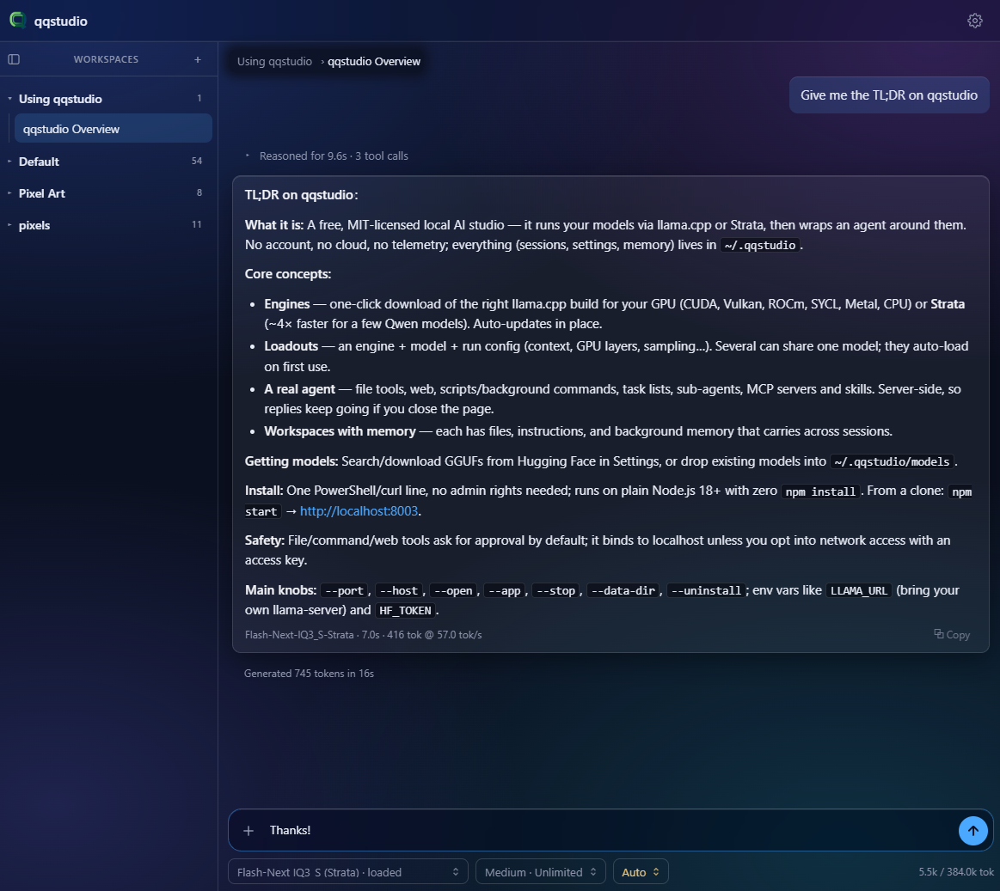

<p align="center"></p>

<p align="center"><br>
<sub>A local AI studio: it runs your models with llama.cpp or Strata, and puts an agent around them, with tools, MCP servers, skills, sub-agents and workspaces that remember.</sub></p>

- **Local and private.** Runs on your PC, no account, no cloud, no telemetry. Sessions, settings and memory are all local.
- **Engines with a button.** Download a llama.cpp build for your graphics card, or Strata (a faster engine for a few models), from Settings. qqstudio suggests the right build and keeps it updated.
- **Loadouts.** An engine, a model and how to run it (context, GPU layers, sampling…). Sessions pick a loadout, and it loads when it's used.
- **A real agent.** Files, web, scripts, background commands, questions, a task list and sub-agents, plus your MCP servers and skills. Tools are easy to add and manage.
- **Workspaces with memory.** Each workspace has its own files and can remember what matters across sessions, so a new session can pick up earlier work.
- **No dependencies.** Plain Node.js 18 or newer. No `npm install`.

## Install

**Windows** (PowerShell):

```powershell
irm https://github.com/quantiqueue/qqstudio/releases/latest/download/install.ps1 | iex
```

**macOS and Linux:**

```sh
curl -fsSL https://github.com/quantiqueue/qqstudio/releases/latest/download/install.sh | sh
```

No admin rights and nothing to install first: it uses your Node.js if it's 18 or newer, otherwise it downloads a private copy just for qqstudio. You get a `qqstudio` command and a shortcut (Start Menu on Windows, your applications menu on Linux, `~/Applications` on a Mac) that opens qqstudio in its own window. Closing the window keeps qqstudio running; on Windows its tray icon has **Open qqstudio** and **Quit qqstudio**, everywhere `qqstudio --stop` stops it.

- **Update:** run the same line again. Your sessions, settings, engines and models (in `~/.qqstudio`) are never touched.
- **Uninstall:** `qqstudio --uninstall`. It asks before deleting engines and models, and separately before deleting your settings and sessions.
- **From a terminal:** `qqstudio` (runs there, Ctrl+C stops it), `qqstudio --open` (opens your browser), `qqstudio --help`.

### First steps

1. **Settings → Engines:** download a llama.cpp build (the suggested one fits your graphics card) or Strata. You can also point at a `llama-server` you already have.
2. **Settings → Install Models:** search Hugging Face and download a GGUF model. Models you already have can go in `~/.qqstudio/models` (LM Studio-style folders work).
3. **Settings → Models:** pick **Create Loadout** on a model, adjust it if you like, and save.
4. **Start a session:** pick the loadout in the composer and send a message. The loadout loads by itself the first time.

## What's in it

### Engines and loadouts

- **llama.cpp builds** for your system (Windows, Linux, macOS; x64 and arm64) and graphics card: CUDA, Vulkan, ROCm, SYCL, Metal or CPU. Each installed build checks for newer ones and updates in place, keeping its loadouts.
- **Strata** runs Qwen3.8-Flash-Next and a few related models much faster than llama.cpp (about 4× on the same files in our tests: 59–70 tok/s instead of 15). qqstudio keeps its copy of Strata separate from a Strata app you installed yourself.
- **Loadouts** hold everything model- or server-related: context size, GPU layers, KV cache, draft model, sampling and more, each with help text. Several loadouts can share a model, for example a long-context one and a fast one.

### Sessions and the agent

- The agent runs on the server, so a reply keeps going when you close the page, and you can follow it from another device.
- **Tools:** list, read (also PDF and Office documents), search, write, edit, move and delete files; search the web and read pages; run commands and scripts, also long-running ones in the background; ask you multiple-choice questions; keep a task list you can see.
- **Sub-agents** take separate pieces of work and report back. Past the limit they wait their turn instead of failing.
- **MCP servers** (stdio and Streamable HTTP, in the Claude Desktop `mcp.json` format) and **skills** (`SKILL.md` folders).
- **Thinking** is shown in folds, with effort and thinking budgets per session. Long sessions are compacted, you can steer a reply while it runs, and secrets in tool results are masked before they're saved.
- **Guards** stop a model that loops or repeats the same tool call.

### Workspaces and memory

- Each workspace has its sessions, a files folder (attachments, pasted pictures and what the model makes) and a description that the model reads as instructions.
- **Memory** (configurable for workspaces) keeps preferences, facts, decisions and work to come back to, with where it lives. It works in the background: there's nothing to approve.

### Safety

- Tools that read or change your files, run commands or reach the web ask before they run, unless you set a session to approve automatically.
- qqstudio listens on this PC only. **Settings → Server → Network access** opens it to your network (to use it from a phone or tablet), protected by an access key.

## Options

Command-line flags (`qqstudio --help`): `--port`, `--host`, `--open`, `--app` (its own window, in the background), `--stop`, `--data-dir`, `--uninstall`, `--version`.

Or set these as environment variables before starting:

| Variable | Default | What it does |
|---|---|---|
| `PORT` | 8003 | Port of the web page |
| `QQSTUDIO_HOME` | `~/.qqstudio` | Where sessions, settings, engines and models are kept |
| `LLAMA_PORT` | 9931 | Port of the running loadout |
| `LLAMA_URL` | | Use a llama-server you run yourself instead of loadouts |
| `GITHUB_TOKEN` | | Raises GitHub's limit for checking engine releases |
| `HF_TOKEN` | | For gated models on Hugging Face |

## Platforms

qqstudio is developed and used on Windows. Linux and macOS are supported in the code (engine downloads, processes and folders for each system). Reports are welcome.

## Troubleshooting

- **It won't start ("EADDRINUSE: address already in use"):** qqstudio (or something else) is already using port 8003. Close it (`qqstudio --stop`), or start with another port (`qqstudio --port 8010`).
- **The model never calls tools:** check its chat template supports tool calls. qqstudio always starts llama.cpp with `--jinja`.
- **Engine releases don't load:** GitHub allows 60 checks an hour without a token. qqstudio shows the last list it got meanwhile, or set `GITHUB_TOKEN`.
- **The page doesn't load from another device:** turn on Network access in Settings → Server, and allow the port through your firewall.

## Support qqstudio

qqstudio is free and [MIT-licensed](LICENSE). I build it, test it and pay for the resources myself. A coffee helps me add more features and keep supporting issues.

<a href="https://buymeacoffee.com/quantiqueue"></a>

Contact me via [GitHub](https://github.com/quantiqueue).

<sub>qqstudio is not affiliated with or endorsed by llama.cpp, Strata, Hugging Face or the makers of the models and MCP servers it works with.</sub>
